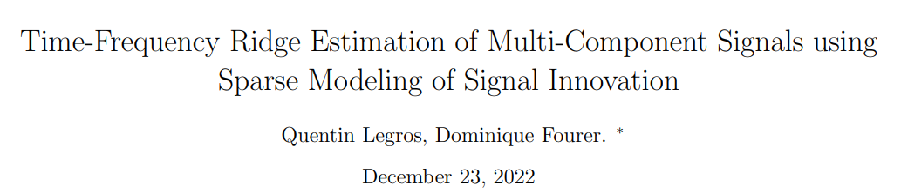
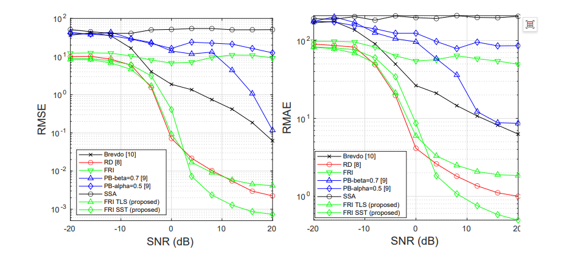
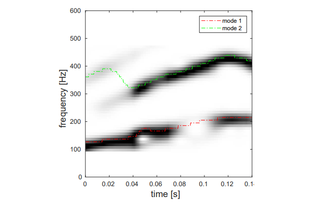
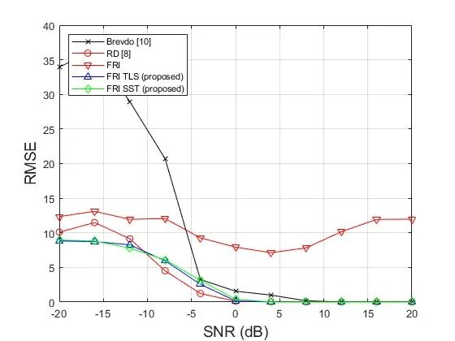
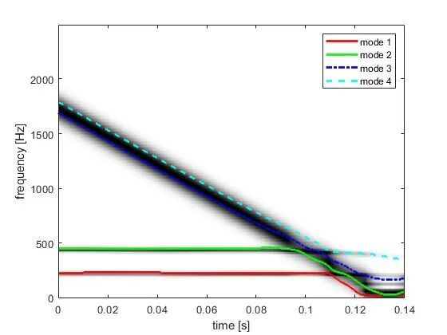

# [Time-Frequency Analysis]Not Depend on Time-Frequency Resolution! TLS+VSST empowers accurate estimation of instantaneous frequency for multicomponent signals[with MATLAB code]

Personal Blog: https://www.cnblogs.com/EWFrontier  
✿New Breakthrough in Multi-component Signal Time-Frequency Ridge Estimation Based on FRI Sparse Modeling ✿1. Article Title: New Approach to Estimating Multi-component Signal Time-Frequency Ridges Based on Sparse Signal Modeling  
2. Abstract: This paper proposes a new method for estimating the modality of observed non-stationary mixed signals. It establishes a connection between short-time Fourier transform and sparse sampling theory, modeling the observed signal as a pulse stream filtered by known functions. Given the finite rate of new information (FRI) of the signal to be recovered, an improved reconstruction method is employed to estimate the signal modality in the presence of noise. The proposed method is compared with existing advanced methods and its performance is validated across different scenarios, confirming its effectiveness. This method lays the foundation for future FRI-based modality separation algorithms.  
3. Introduction: Complex signals generated by extensive physical systems are often modeled as multi-component signals (MCS), composed of multiple amplitude-modulated-frequency-modulated (AM-FM) sinusoidal signals. Depending on the application scenario, it is often necessary to extract these components to separate the signal modality. For this purpose, the observed signal is typically projected onto the time-frequency (TF) plane. In fact, linear time-frequency transformations such as Short-Time Fourier Transform (STFT) have gained increasing attention in recent decades due to their computational ease and ability to highlight signal components. The time-frequency representation (TFR) of multi-component signals provides a concise framework where the instantaneous frequency (IF) trajectory of each modality can be viewed as a ridge line on a two-dimensional plane. These ridge lines gather critical information for denoising, extracting specific information, or separating source signals.
Although the modal estimation of multi-component signals appears simple, the presence of noise limits the use of traditional methods. The performance of instantaneous frequency estimation is influenced by the presence or absence of outliers and the quality of the observed signal. Existing research has proposed techniques to estimate instantaneous frequencies by interpolating local maxima along the frequency axis; recent studies have extracted regions corresponding to the relevant ridge lines from spectral plots to interpolate the remaining ridge segment segments that are split by external noise; other studies have adopted a pseudo Bayesian (PB) framework to estimate instantaneous frequencies in an iterative manner at each time step by assuming density filtering method; another approach utilizes the entire spectral plot to estimate ridge line positions without relying on iterative ridge tracking; there are also studies that employ the Prony method on enhanced time-frequency representations to address the problem of linear restoration in degraded images, which is applicable to the modal estimation of multi-component signals, but the deblurring of significant frequency changes in ridge lines may compromise this approach.
This paper proposes a new method for the estimation of instantaneous frequency in multi-component signals based on spectral graph estimation: firstly, by modeling the location of the ridge lines, it establishes a connection with sparse sampling theory, treating the observed spectral graph as a distorted version of the Dirac pulse (DP) flowing through a time-frequency representation analysis window. Since the target signal has a finite new information rate (FRI), its reconstruction is an established problem. To address false noise events, this paper adopts the Total Likelihood Sum (TLS) method instead of the traditional Prony method. One advantage of this method is that the final instantaneous frequency estimate does not rely on the time-frequency resolution grid, enabling the acquisition of true estimates independent of the time-frequency representation mode. This paper also discusses the use of vertical synchronous squeezed transform (VSST) as an alternative sharpening representation for the signal's spectral graph.
The main contributions of this paper include:
•  
Propose a new multi-component signal spectrum sparse observation model;
•  
A finite-aperture reconstruction strategy with synchronization extrusion transformation;
•  
A method for estimating instantaneous frequency that is independent of time-frequency representation resolution.
4. Method Introduction The core of this method is to transform the time-frequency ridge estimation problem of multi-component signals into the reconstruction problem of finite-rate (FRI) signals, and the specific process is as follows:
(1)Observation Model: The discrete-time finite-length multicomponent signal consists of K amplitude-modulated-frequency modulated (AM-FM) components superimposed. Its short-time Fourier transform squared modulus (i.e., spectrum) can be modeled as a Gaussian function mixture where each time point's spectrum vector is composed of the weighted sum of the instantaneous amplitude squares and the mean instantaneous frequency. Further, the estimated signal is represented as a Dirac delta pulse stream (with non-zero values only at the peak locations corresponding to instantaneous frequency and amplitude), and the spectrum is the result of this pulse stream passing through a specific function filter.
(2) Reconstruction Strategy:
Noiseless scenario: By leveraging the characteristics of finite new information rate signals, with only 2K+1 Fourier series coefficients known for the Dirac delta pulse stream, the position (corresponding to instantaneous frequency) and weight (corresponding to instantaneous amplitude) of the pulse can be restored using the Vandermonde matrix inversion and annihilation filter method.
Noisy scenario: Due to noise, the inversion of the Vandermonde matrix becomes ill-posed. A Total Least Squares (TLS) algorithm replaces the Prony method, solving for an approximate annihilation filter via Singular Value Decomposition (SVD). This enhances noise resistance. Simultaneously, by combining the vertical synchronization squashing transformation (VSST) sharpening the time-frequency representation, the energy at each peak line is reallocated to the instantaneous frequency, adapting to estimate all signal components with a single filter kernel.
5. Conclusion This paper proposes a new method for estimating the ridgelines of multi-component signals under noise conditions. The method assumes that the reconstructed signal is sparse—each component corresponds to a pulse at a given time, whose position represents the instantaneous frequency of that component. The spectral slices are treated as filtered Dirac pulse samples corrupted by noise, thereby transforming the problem into the recovery of finite-newtonian signal with limited information rate. Since noise affects the effectiveness of the Prony method, this paper adopts the overall least squares method as an alternative. Comparative results with existing advanced methods show that the instantaneous frequency estimation performance significantly improves. Additionally, a simple alternative solution is proposed that only requires additional transformations on the signal to handle components that spread inconsistently across the frequency plane. Future research directions should focus on efficient separation of estimated components and exploring adaptive spatial regularization methods.
★

## Images

<!-- PAYMENT_BLOCK -->

## Get this dataset

- Payment link (Stripe): [Buy now](https://buy.stripe.com/3cs8yP7sY87d0vu9AB)
- Payment QR code: 

<!-- /PAYMENT_BLOCK -->
